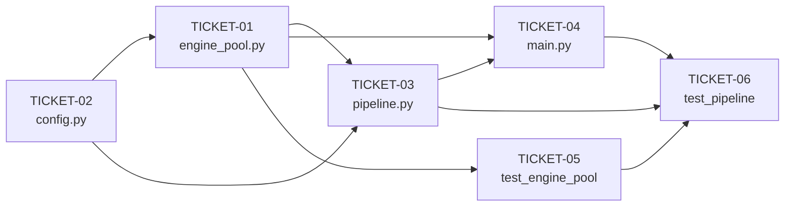

# Phiếu Giao Việc — Song song hóa Two-Pass Pipeline

> Mỗi phiếu là một đơn vị công việc độc lập. Thực hiện **theo đúng thứ tự** vì có quan hệ phụ thuộc.
> Điều chỉnh so với plan gốc được ghi chú bằng 🔧.

---

## TICKET-01 — [NEW] `engine_pool.py`

| Mục | Chi tiết |
|-----|----------|
| **File** | `src/engine/engine_pool.py` *(tạo mới)* |
| **Phụ thuộc** | Không có |
| **Thực hiện sau** | — |
| **Thực hiện trước** | TICKET-03, TICKET-04 |

### Mục tiêu
Tạo class `EnginePool` quản lý vòng đời của 2 tiến trình Stockfish. Đóng gói dưới dạng context manager để đảm bảo không rò rỉ tiến trình dù có ngoại lệ.

### Yêu cầu cụ thể
- Nhận `engine_path: str`, `cfg: Config`, `workers: int = 2` (🔧 thay `pool_size` → `workers` cho nhất quán với `Config`)
- Khởi tạo danh sách `engines: list[StockfishEngine]` trong `__enter__`
- 🔧 Thêm hai property có tên rõ ràng:
  - `.scanner` → `engines[0]` — Engine dùng cho fast scan + work-stealing
  - `.hot_worker` → `engines[1]` — Engine dùng cho dedicated deep worker
- `__exit__` gọi `close()` ngay cả khi có exception; mỗi engine được `try/except` riêng để lỗi 1 engine không chặn đóng cái còn lại
- `close()` cuối cùng gọi `engines.clear()`

### Đầu ra kỳ vọng
```
with EnginePool(path, cfg) as pool:
    pool.scanner      # → StockfishEngine instance 1
    pool.hot_worker   # → StockfishEngine instance 2
# Sau with: cả 2 stockfish.exe đã quit() sạch
```

### Checklist hoàn thành
- [ ] File tồn tại, không lỗi `py_compile`
- [ ] `with EnginePool(...)` khởi tạo đúng 2 engine
- [ ] `pool.scanner` và `pool.hot_worker` truy cập đúng
- [ ] Đóng bình thường không có exception
- [ ] Đóng khi có exception vẫn gọi quit() trên cả 2 engine

---

## TICKET-02 — [MODIFY] `config.py`

| Mục | Chi tiết |
|-----|----------|
| **File** | `src/core/config.py` |
| **Phụ thuộc** | Không có |
| **Thực hiện sau** | — |
| **Thực hiện trước** | TICKET-01, TICKET-03, TICKET-04 |

### Mục tiêu
Thêm các trường cấu hình song song vào `Config` dataclass.

### Yêu cầu cụ thể
- Thêm trong nhóm `# song song hóa (NEW)`:
  - `parallel: bool = False` — kích hoạt cơ chế 2 Stockfish
  - `workers: int = 2` — số lượng engine trong pool (🔧 nhất quán với `EnginePool.workers`)
- Giữ nguyên `frozen=True` và toàn bộ các trường hiện có
- Không thay đổi `NAG_MAP`

### Ràng buộc thiết kế
- `parallel=True` chỉ có hiệu lực khi `two_pass=True`; pipeline sẽ log cảnh báo nếu `parallel=True` mà `two_pass=False`
- `workers` mặc định = 2, không hỗ trợ > 2 trong phiên bản này (🔧 giới hạn rõ ràng, tránh over-engineer)

### Checklist hoàn thành
- [ ] `Config(parallel=True, workers=2)` khởi tạo không lỗi
- [ ] `Config()` vẫn cho kết quả mặc định giống cũ (backward compat)
- [ ] Không lỗi `py_compile`

---

## TICKET-03 — [MODIFY] `pipeline.py`

| Mục | Chi tiết |
|-----|----------|
| **File** | `src/analyzer/pipeline.py` |
| **Phụ thuộc** | TICKET-01 (`EnginePool`), TICKET-02 (`Config.parallel`) |
| **Thực hiện sau** | TICKET-01, TICKET-02 |
| **Thực hiện trước** | TICKET-04, TICKET-05 |

### Mục tiêu
Thêm hàm `analyse_game_parallel()` vào pipeline. Hàm cũ `analyse_game()` **KHÔNG ĐƯỢC CHỈNH SỬA**.

### Các thành phần cần tạo trong file

#### A. Dataclass `HotTask`
Đặt ở đầu file, chứa đủ dữ liệu để deep-evaluate một nước đi hot mà không cần board đang chạy:

| Trường | Kiểu | Ghi chú |
|--------|------|---------|
| `ply` | `int` | Thứ tự nước đi |
| `board` | `chess.Board` | **Bản sao** (`board.copy(stack=False)`) của thế trước nước đi |
| `move` | `chess.Move` | Nước cần đào sâu |
| `sac_fast` | `int` | 🔧 Giá trị `sac_value` từ fast eval — cần cho Phase 3 merge classify |

#### B. Hàm `analyse_game_parallel(game, engine_pool, cfg, is_book, find_hits)`
Gồm 3 giai đoạn:

**Phase 1 — Fast Scan (SF1, thread chính):**
- Vòng lặp qua từng nước đi trong ván
- Với mỗi nước: `fast_eval.evaluate_move(board, move, ply, depth=cfg.fast_depth, multipv=cfg.fast_multipv)`
- Lưu kết quả vào `fast_evals: dict[int, MoveEval]`
- Tính `sac_fast = _sac(board, ev, cfg)` ngay tại đây
- Nếu `is_hot(ev, sac_fast, cfg)` → `hot_queue.put(HotTask(ply, board.copy(stack=False), move, sac_fast))`
- Đẩy `board.push(move)` sau mỗi nước

**Phase 2 — Work-Stealing (SF1 nhảy vào phụ sau khi scan xong):**
- Dùng `hot_queue.get_nowait()` trong vòng lặp `while True` với `try/except Empty`
- SF1 reuse lại cùng `fast_eval` evaluator nhưng gọi với `depth=cfg.depth, multipv=cfg.multipv`
- Kết quả lưu vào `deep_evals: dict[int, MoveEval]`
- Sau khi `Empty`: gửi `None` sentinel vào queue cho SF2 → `hot_queue.put(None)` → `worker_thread.join()`

**Worker Thread cho SF2 (chạy từ trước Phase 1):**
- Vòng lặp `while True: item = hot_queue.get()`
- Nếu `item is None` → break
- Evaluate với `depth=cfg.depth, multipv=cfg.multipv`, lưu vào `deep_evals` (shared dict, OK vì mỗi ply chỉ do 1 worker write)

**Phase 3 — Merge & Classify:**
- Với mỗi ply theo thứ tự tăng dần:
  - `ev = deep_evals.get(ply, fast_evals[ply])` — ưu tiên deep nếu có
  - 🔧 Lấy `sac` từ `deep_evals[ply]` nếu có, hoặc từ `HotTask.sac_fast` nếu không → tránh tính lại `_sac()` hai lần
  - Chạy `classify`, `find_hits`, `make_comment`, lắp vào `MoveReport`

#### C. Precondition Guard
🔧 Ngay đầu `analyse_game_parallel`: nếu `not cfg.two_pass`, log cảnh báo và fallback sang `analyse_game()`.

### Checklist hoàn thành
- [ ] `analyse_game()` cũ còn nguyên vẹn, không bị chỉnh dòng nào
- [ ] `HotTask` có đủ 4 trường, kể cả `sac_fast`
- [ ] Worker thread SF2 khởi động trước Phase 1
- [ ] SF1 đẩy sentinel sau khi work-stealing xong (không phải ngay sau fast scan)
- [ ] `worker_thread.join()` được gọi trước khi vào Phase 3
- [ ] `deep_evals` và `fast_evals` không bị write đồng thời cùng ply
- [ ] Precondition guard tồn tại
- [ ] Không lỗi `py_compile`

---

## TICKET-04 — [MODIFY] `main.py`

| Mục | Chi tiết |
|-----|----------|
| **File** | `main.py` |
| **Phụ thuộc** | TICKET-01, TICKET-02, TICKET-03 |
| **Thực hiện sau** | TICKET-01, 02, 03 |
| **Thực hiện trước** | TICKET-05, TICKET-06 |

### Mục tiêu
Wire toàn bộ tính năng mới vào CLI. Flow cũ (không `--parallel`) giữ nguyên 100%.

### Yêu cầu cụ thể
- Thêm argument: `--parallel` (action `store_true`, help rõ ràng)
- Thêm import `EnginePool`, `analyse_game_parallel`
- Logic phân nhánh:
  ```
  Nếu a.fast AND a.parallel:
      Dùng EnginePool + analyse_game_parallel
  Ngược lại:
      Dùng StockfishEngine + analyse_game (giữ nguyên code hiện tại)
  ```
- `EnginePool` phải nằm trong `with` block để đảm bảo cleanup
- 🔧 Thêm warning nếu người dùng truyền `--parallel` mà không có `--fast` (parallel vô nghĩa nếu không two_pass)

### Checklist hoàn thành
- [x] `python main.py --help` hiển thị `--parallel`
- [x] Chạy không có `--parallel` → flow cũ, không import `EnginePool`
- [x] Chạy có `--parallel` mà không có `--fast` → in cảnh báo và chạy flow cũ
- [x] Không lỗi `py_compile`

---

## TICKET-05 — [TEST] `tests/engine/test_engine_pool.py`

| Mục | Chi tiết |
|-----|----------|
| **File** | `tests/engine/test_engine_pool.py` *(tạo mới)* |
| **Phụ thuộc** | TICKET-01 |
| **Thực hiện sau** | TICKET-01 |

### Mục tiêu
Kiểm tra vòng đời `EnginePool` với engine thật (Stockfish 19 tại `data/engines/stockfish.exe`).

### Các test case cần có

| Test | Mô tả |
|------|-------|
| `test_pool_creates_two_engines` | Sau `__enter__`, `pool.engines` có đúng 2 phần tử |
| `test_scanner_hot_worker_accessible` | `pool.scanner` và `pool.hot_worker` không phải `None` và là `StockfishEngine` |
| `test_pool_closes_on_exit` | Sau `with`, kiểm tra không còn tiến trình `stockfish.exe` zombie |
| `test_pool_closes_on_exception` | Raise exception trong `with` → `__exit__` vẫn được gọi, engine đóng sạch |

### Cách chạy
```powershell
python -m pytest tests/engine/test_engine_pool.py -v
```

### Checklist hoàn thành
- [x] Tất cả test case tồn tại (dù skip nếu chưa có Stockfish)
- [x] Test tự phát hiện đường dẫn Stockfish tại `data/engines/stockfish.exe`
- [x] Không có tiến trình zombie sau khi test chạy xong

---

## TICKET-06 — [TEST] `tests/analyzer/test_pipeline.py`

| Mục | Chi tiết |
|-----|----------|
| **File** | `tests/analyzer/test_pipeline.py` |
| **Phụ thuộc** | TICKET-03, TICKET-04, TICKET-05 |
| **Thực hiện sau** | TICKET-01 → 05 |

### Mục tiêu
Kiểm tra hai điều:
1. **Equivalence**: Kết quả `analyse_game_parallel` phải tương đương `analyse_game` về nhãn phân loại
2. **Performance**: `analyse_game_parallel` phải nhanh hơn `analyse_game` (với `two_pass=True`)

### Các test case cần có

| Test | Mô tả |
|------|-------|
| `test_parallel_labels_match_sequential` | Dùng `opera_game.pgn`, so sánh danh sách `Label` của từng nước giữa hai mode |
| `test_parallel_is_faster_than_sequential` | Đo `timeit`, xác nhận parallel < sequential * 0.85 (tức nhanh hơn ≥15%) |
| `test_parallel_requires_two_pass` | Nếu `cfg.parallel=True, cfg.two_pass=False` → fallback hoặc warning, không crash |
| `test_parallel_handles_no_hot_moves` | Ván cờ toàn nước không hot → queue rỗng, SF2 thread nhận sentinel ngay, kết quả vẫn đúng |
| `test_parallel_all_hot_moves` | Ván cờ toàn nước hot → SF1 và SF2 đều đào sâu đủ, không deadlock |

### Cách chạy
```powershell
python -m pytest tests/analyzer/test_pipeline.py -v -s
```

### Checklist hoàn thành
- [x] `test_parallel_labels_match_sequential` pass
- [x] `test_parallel_is_faster_than_sequential` pass (với `fast_depth=14, depth=20`)
- [x] Không có deadlock khi chạy test (timeout < 120s)
- [x] Không có zombie process sau test

---

## Thứ tự thực hiện



> [!NOTE]
> TICKET-02 và TICKET-01 có thể làm song song nhau. TICKET-03 phải chờ cả hai.
