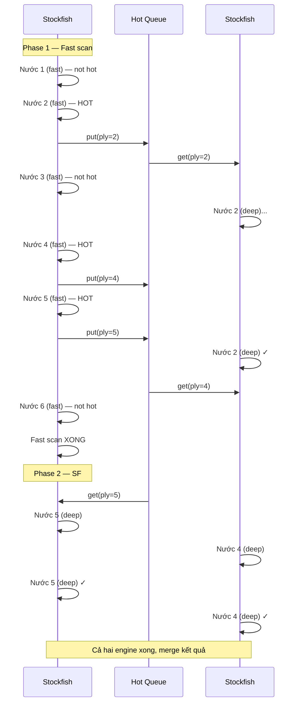

# Thiết kế Song song hóa Two-Pass Pipeline (v2)

## Thay đổi so với v1

> [!IMPORTANT]
> **SF#1 sau khi quét fast xong → nhảy vào queue làm deep cùng SF#2.**
> Cả 2 engine đều là consumer của hot queue → song song thật sự.

## Luồng hoạt động



## Timeline so sánh

```
TUẦN TỰ (hiện tại, two_pass=True):
SF#1: [fast1][fast2][fast3][fast4][fast5][fast6][deep2][deep4][deep5]
Tổng: ═══════════════════ N×fast + H×deep ═══════════════════════

SONG SONG v1 (SF#1 ngồi không):
SF#1: [fast1][fast2][fast3][fast4][fast5][fast6]  ← idle !!!
SF#2:        [====deep2====][====deep4====][====deep5====]
Tổng: ═══════════════════ max(N×fast, H×deep) ══════════

SONG SONG v2 (SF#1 phụ deep):
SF#1: [fast1][fast2][fast3][fast4][fast5][fast6][deep5]  ← phụ!
SF#2:        [====deep2====][====deep4====]
Tổng: ═══════════════ NGẮN HƠN nữa ══════════════
```

## Thiết kế code

### Cơ chế: Shared Queue + 2 Consumers

```python
hot_queue = Queue()   # thread-safe

# SF#2 thread: consumer từ đầu
def deep_worker(engine, queue, results):
    evaluator = Evaluator(engine, cfg)
    while True:
        item = queue.get()
        if item is None:        # sentinel = hết việc
            break
        ply, board, move = item
        results[ply] = evaluator.evaluate_move(board, move, ply)
        queue.task_done()

# Main thread: SF#1 làm fast → xong rồi cũng consume queue
def analyse_game_parallel(...):
    fast_eval = Evaluator(pool.fast_engine, cfg)
    deep_results = {}
    
    # Khởi động SF#2 thread
    t = Thread(target=deep_worker, args=(pool.deep_engine, hot_queue, deep_results))
    t.start()
    
    # --- Phase 1: SF#1 fast scan ---
    for ply, node in enumerate(game.mainline(), 1):
        ev = fast_eval.evaluate_move(board, move, ply,
                                     depth=cfg.fast_depth, multipv=cfg.fast_multipv)
        fast_results[ply] = ev
        if is_hot(ev, sac, cfg):
            hot_queue.put((ply, board.copy(), move))
        board.push(move)
    
    # --- Phase 2: SF#1 NHẢY VÀO PHỤ deep ---
    # SF#1 cũng consume queue cho đến khi hết
    deep_eval_1 = Evaluator(pool.fast_engine, cfg)  # reuse SF#1 cho deep
    while True:
        try:
            item = hot_queue.get_nowait()
        except Empty:
            break
        if item is None:
            break
        ply, board_copy, move = item
        deep_results[ply] = deep_eval_1.evaluate_move(board_copy, move, ply)
    
    # Gửi sentinel cho SF#2 thread rồi chờ
    hot_queue.put(None)
    t.join()
    
    # --- Phase 3: Merge ---
    for ply in sorted(fast_results):
        ev = deep_results.get(ply, fast_results[ply])
        # classify, verdict, comment...
```

> [!TIP]
> **Evaluator cache** tách riêng cho mỗi engine (fast_eval vs deep_eval) → không bị race condition vì mỗi Evaluator dùng `dict` riêng, và mỗi dict chỉ 1 thread truy cập.

## Files cần tạo/sửa

| File | Hành động |
|------|-----------|
| [`engine_pool.py`](file:///e:/PROJECT/workprj/chess_analyzer/src/engine/engine_pool.py) | **Tạo mới** — quản lý 2 SF instances |
| [`pipeline.py`](file:///e:/PROJECT/workprj/chess_analyzer/src/analyzer/pipeline.py) | **Sửa** — thêm `analyse_game_parallel()` |
| [`config.py`](file:///e:/PROJECT/workprj/chess_analyzer/src/core/config.py) | **Sửa** — thêm `parallel` flag |
| [`main.py`](file:///e:/PROJECT/workprj/chess_analyzer/main.py) | **Sửa** — thêm `--parallel`, dùng EnginePool |
